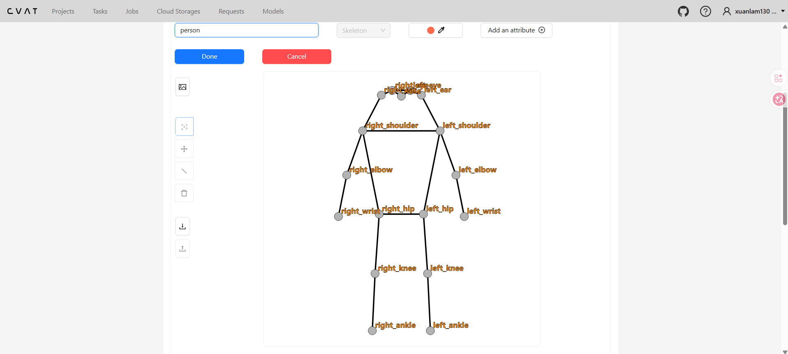
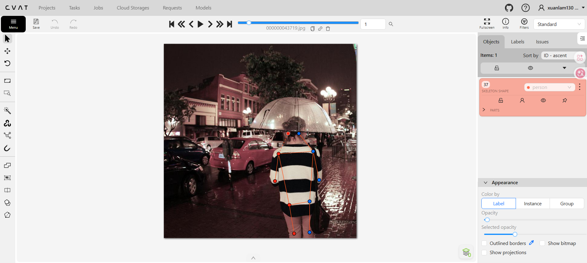
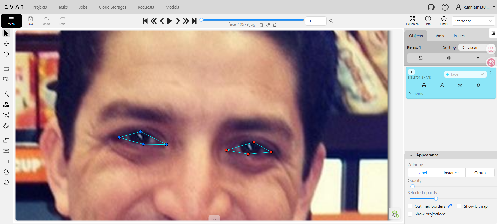
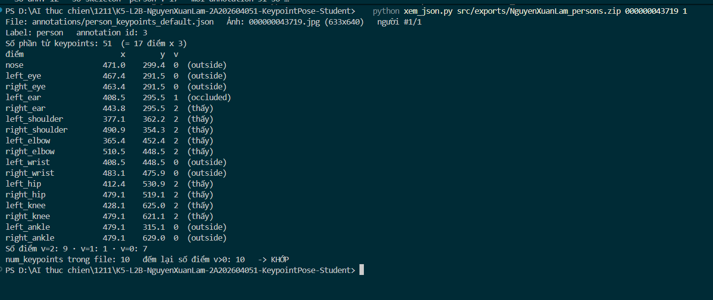

# Báo cáo cá nhân — NguyenXuanLam-2A202604051

Dữ liệu: 12 ảnh người COCO 2017 (Lin et al., 2014) và 8 ảnh khuôn mặt cắt từ ảnh COCO 2017 (CC BY / CC BY-SA), chỉ dùng trong lớp.

## 0. Thông tin học viên

- Họ tên: Nguyễn Xuân Lam
- MSSV: 2A202604051
- Email: xuanlam13072004@gmail.com
- Link repository: https://github.com/xuanlam13072004/K5-L2B-NguyenXuanLam-2A202604051-KeypointPose-Student
- Phiên bản CVAT (Help → About): 2.74.1
- Máy: hệ điều hành Windows (PowerShell 5.1, Docker Desktop) · RAM 16 GB · chạy CVAT chế độ đầy đủ, bật thêm Nuclio (serverless)
- Bộ ảnh (`src/exports/assignment.json` do `lab.py setup` tạo): có
- Giờ bắt đầu: 16:30
- Giờ kết thúc: 18:30

## 1. Kiểm tra label (CP0)

| Label | Kiểu | Số điểm | Tên điểm đúng bảng của lab? | Đúng thứ tự? | Số cạnh |
|---|---|---:|---|---|---:|
| `person` | Skeleton | 17 | Có | Có | 19 |
| `face` | Skeleton | 13 | Có | Có | 13 |

Mẫu `person` dựng theo người quay mặt về camera (các điểm `left_*` nằm bên phải khung mẫu)? Có

Cách đổi cờ `occluded` / `outside` cho **một điểm** trên phiên bản CVAT này (một câu):

Rê chuột vào đúng điểm rồi bấm `Q` (occluded) hoặc `O` (outside); khi điểm bị chồng lên nhau thì mở skeleton trong bảng **Objects** bên phải và bấm biểu tượng occluded / outside ở dòng tên điểm đó — chỉ điểm đó đổi cờ.

## 2. Số lượng đã gán và thời gian (CP1, CP2)

| Nhóm ảnh | Số ảnh | Số skeleton đã gán | Số người dưới 60 px (không gán) | Số poster / gương / màn hình bỏ qua | Thời gian (phút) |
|---|---:|---:|---:|---:|---:|
| `easy` | 5 | 5 | 0 | 0 | — |
| `occluded` | 3 | 5 | 0 | 0 | — |
| `back` | 2 | 3 | 0 | 0 | — |
| `small` | 1 | 1 | 3 | 0 | — |
| `crowd` | 1 | 3 | 2 | 0 | — |
| `faces` | 8 | 8 | — | 0 | — |

Chi tiết: `occluded` gồm 030960 = 2, 183176 = 1, 516902 = 2 (người lớn + cậu bé áo xanh phía sau); `back` gồm 043719 = 1, 518966 = 2 (cô gái đeo balo + người ôm ván ở mép phải); `small` 323705 = 1 (người ở ban công bên phải, nửa dưới bị lan can che) và 3 người dưới 60 px không gán; `crowd` 326480 = 3 và 2 người ở hậu cảnh dưới 60 px không gán.

Ở 183176 không gán người ngồi sau người lái: chỉ thấy một bàn tay trên vai, một phần tóc và hai mảnh chân; mặt, vai, thân và hông đều bị người lái che, phần lớn điểm không đoán chắc được.

- Tổng thời gian: khoảng 120 phút (16:30–18:30), gồm cài model (Nuclio, HRNet, MediaPipe), chạy model gán trước, sửa tay 12 ảnh người và 8 ảnh mặt, tự review và xuất file. Không bấm giờ riêng từng phần nên cột thời gian để trống.
- Ảnh tốn thời gian nhất là ảnh nào, vì sao?

Ảnh 323705 (nhóm `small`, đồng hồ ở nhà ga): người ở hậu cảnh rất nhỏ, tối và ngược sáng nên khó nhìn rõ từng người, phải phóng to và kéo khung để đo xem ai cao từ 60 px, ai dưới 60 px.

## 3. Bảng ca khó (CP1, CP2)

Mỗi điểm bạn phân vân một dòng, nhất là phân vân giữa `v = 1` và `v = 0`, hoặc không chắc hướng người.

| Ảnh | Người / mặt | Điểm | Cờ đã chọn | Phân vân giữa | Lý do chọn |
|---|---|---|---:|---|---|
| 000000030960 | Cô dâu (người 2) | `right_elbow` | 1 | `v = 1` / `v = 0` | Khuỷu tay phải bị người chú rể che; model để `outside`, nhưng nối từ vai phải xuống cổ tay đang nắm tay chú rể thì đoán chắc được khuỷu → `v = 1` |
| 000000030960 | Cô dâu (người 2) | `left_hip`, `right_hip` | 1 | `v = 1` / `v = 0` | Hông bị váy cưới che kín; model để `outside`, nhưng eo và dáng người rõ nên ước lượng được → `v = 1` |
| 000000030960 | Cô dâu (người 2) | `right_wrist` | 2 | `v = 2` / `v = 0` | Model để `outside`; nhìn kỹ thì hai bàn tay đang nắm nhau ở giữa ảnh, cổ tay thấy được → `v = 2` |
| 000000043719 | Người quay lưng | `nose`, `left_eye`, `right_eye` | 0 | `v = 1` / `v = 0` | Lúc đầu để `v = 1`, nhưng người quay lưng hoàn toàn, không thấy mặt, vị trí chỉ là đoán (mũi còn lệch ra ngoài tai) → không đoán chắc → `v = 0` |
| 000000323705 | Người ở ban công bên phải | Cả skeleton | giữ | gán / không gán | Người rất nhỏ, tối, khó nhìn; phần điểm thấy được chỉ cao 48 px nhưng nửa dưới bị lan can che, cả người ước lượng trên 60 px nên vẫn gán; các điểm chân sau lan can để `v = 0` |
| 000000183176 | Người ngồi sau xe máy | Cả skeleton | không gán | gán / không gán | Chỉ thấy một bàn tay trên vai người lái, ít tóc và hai mảnh chân; mặt, vai, thân, hông bị che quá nhiều, phần lớn điểm không đoán chắc được nên không gán |

## 4. Bảng tự review (CP3)

<!-- TỰ VIẾT (RULES.md: không dùng AI cho mục này). Từ ảnh cuối về ảnh đầu, ≥ 8 dòng. -->

Đi từ ảnh cuối về ảnh đầu. 5 ảnh người (ít nhất 2 ảnh `back` hoặc `crowd`) và 3 ảnh mặt. Ít nhất 8 dòng, kể cả dòng `ok`. Ghi lỗi trước, sửa sau.

| Ảnh | Người / mặt | Điểm | Mã lỗi | Ghi chú | Đã sửa? |
|---|---|---|---|---|---|
| 000000518966 | Cô gái balo + người ôm ván | — | `ok` | Kiểm lại hướng người (quay lưng, `left_*` bên trái ảnh), cờ và đủ 2 người: không có lỗi | — |
| 000000516902 | Cậu bé áo xanh (người 2) | `left_eye`, `right_eye`, `left_ear` | `vis_flag` | Đầu bị cắt ở mép trên; model đặt 3 điểm ra ngoài ảnh (y âm) với `v = 2`, script tự kiểm báo `[LỖI]` → đổi `outside` | Có |
| 000000326480 | 3 người | — | `ok` | Kiểm lại trái/phải từng người (2 người nghiêng), không có xương vắt sang người khác, người hậu cảnh dưới 60 px không gán: không có lỗi | — |
| 000000043719 | Người quay lưng | `nose`, `left_eye`, `right_eye` | `vis_flag` | Để `v = 1` nhưng quay lưng, không thấy mặt, không đoán chắc → `v = 0` | Có |
| 000000030960 | Cô dâu (người 2) | `right_wrist` | `vis_flag` | Model để `outside` (`v = 0`) nhưng bàn tay thấy rõ → `v = 2`, kéo về đúng cổ tay | Có |
| 000000030960 | Cô dâu (người 2) | `right_elbow`, `left_hip`, `right_hip` | `vis_flag` | Model để `outside` nhưng bị che và đoán chắc được → `v = 1`, kéo về đúng khớp | Có |
| face_483667 | Mặt tóc che | 4 điểm mắt trái | `vis_flag` | Khi chạy thử model, mắt trái trong bóng tóc bị đoán nhầm là kính râm (`v = 1`) dù vẫn thấy mắt → giữ `v = 2` | Có |
| face_476363 | Mặt nghiêng | 4 điểm mắt trái | `vis_flag` | Mắt phía xa trong bóng tối bị đoán nhầm là kính râm (`v = 1`) → giữ `v = 2` | Có |
| face_405456 | Mặt kính râm | 8 điểm mắt | `ok` | Kiểm trong file JSON: 8 điểm mắt `v = 1`, 5 điểm mũi–miệng `v = 2`, `num_keypoints` = 13 | — |

Tổng hợp số lỗi theo mã:

| `lr_swap` | `vis_flag` | `position` | `missing` | `extra` | `ok` |
|---:|---:|---:|---:|---:|---:|
| 0 | 6 | 0 | 0 | 0 | 3 |

Điểm còn phân vân giữa `v = 1` và `v = 0` (ghi cả hai lựa chọn và lý do chọn):

- 000000043719, `left_ear`: tóc che phần lớn tai. Nếu chọn `v = 1` là coi như đoán chắc vị trí tai từ đầu và cổ; nếu chọn `v = 0` là coi như không thấy. Đã chọn theo việc có thấy viền tai hay không khi phóng to.
- 000000030960, hông cô dâu: `v = 1` (đoán từ eo và dáng người) hay `v = 0` (váy che kín). Chọn `v = 1` vì dáng người rõ, vị trí hông không mơ hồ.

## 5. Kiểm file xuất và kết quả tự kiểm (CP4)

Tự kiểm tay trong file JSON:

Kiểm bằng script đọc `annotations/person_keypoints_default.json` trong zip, in `(x, y, v)` từng điểm và đếm lại số điểm `v > 0`.

| File | Người / mặt kiểm (ảnh, thứ tự) | Số phần tử `keypoints` | Điểm `outside` ra `v = 0`, `occluded` ra `v = 1`? | `num_keypoints` khớp? |
|---|---|---:|---|---|
| `NguyenXuanLam_persons.zip` | 000000030960, người 2 (cô dâu) | 51 | Có (`right_ear` occluded → 1; cổ chân, gối outside → 0) | Có |
| `NguyenXuanLam_persons.zip` | 000000043719, người 1 (quay lưng) | 51 | Có (cổ tay, cổ chân outside → 0) | Có |
| `NguyenXuanLam_faces.zip` | face_405456 (kính râm) | 39 | Có (8 điểm mắt occluded → 1, 5 điểm còn lại 2) | Có (13) |

Khi kiểm tay phát hiện thêm lỗi cờ chưa được script tự kiểm báo (vì đúng định dạng nhưng sai quy tắc), đã sửa trên CVAT rồi xuất lại: 043719 mũi và hai mắt người quay lưng đang `v = 1` (vị trí đoán, mũi còn nằm lệch ra ngoài tai) → `outside`; 030960 cô dâu `right_wrist` model để `outside` dù tay thấy rõ → `v = 2`, `right_elbow` và hai hông → `occluded`. Một điểm `outside` vẫn mang tọa độ đoán sai của model (`right_ankle` cô dâu ở y = 47, trên đầu) nhưng vì `v = 0` nên không được dùng.

Sau khi xuất, CVAT ghi `occluded` thành `v = 1` và `outside` thành `v = 0`. Tọa độ của điểm `outside` trong file là `0, 0` hay tọa độ cũ? Tọa độ cũ (CVAT 2.x; điểm `v = 0` bị bỏ qua khi huấn luyện và khi chấm).

Hai job đã chuyển sang completed trên CVAT? Có

Dán phần **TÓM TẮT** in ra từ `src/check_submission.py`:

```text
- File person: NguyenXuanLam_persons.zip
  Số ảnh: 12 · số skeleton `person`: 17 · mỗi annotation 51 số
  Skeleton theo ảnh: 000000030960=2, 000000043719=1, 000000183176=1, 000000194027=1, 000000213933=1, 000000261732=1, 000000295358=1, 000000323705=1, 000000326480=3, 000000493741=1, 000000516902=2, 000000518966=2
  Cờ v: v=2 192 (66%) · v=1 48 (17%) · v=0 49 (17%)
  num_keypoints trung bình: 14.1
- File face: NguyenXuanLam_faces.zip
  Số ảnh: 8 · số skeleton `face`: 8 · mỗi annotation 39 số
  Skeleton theo ảnh: face_10579=1, face_257657=1, face_342273=1, face_405456=1, face_421231=1, face_476363=1, face_483667=1, face_79591=1
  Cờ v: v=2 96 (92%) · v=1 8 (8%) · v=0 0 (0%)
  num_keypoints trung bình: 13.0
- Ghi chú: 49 điểm v = 0 vẫn mang tọa độ cũ (CVAT 2.x xuất như vậy; chuẩn COCO ghi 0, 0). Không phải lỗi: điểm v = 0 bị bỏ qua khi huấn luyện và khi chấm.
- Số [LỖI]: 0 · số [CẢNH BÁO]: 1
Kết quả: ĐẠT (đọc lại từng cảnh báo ở trên)
```

Các `[CẢNH BÁO]` còn giữ nguyên và lý do:

- `000000323705.jpg #1: các điểm chỉ trải cao 48 px (< 60 px)`: giữ nguyên. 48 px chỉ là khoảng từ mắt đến hông (nửa trên người); nửa dưới bị lan can ban công che. Ước lượng cả người cao khoảng gấp đôi, trên 60 px, nên vẫn gán; gối và cổ chân sau lan can để `outside`. Đúng trường hợp "người cao hơn nhưng bị cắt" mà cảnh báo cho phép bỏ qua.

Lần xuất trước có 3 `[LỖI]` ở `000000516902.jpg #2` (cậu bé phía sau bị cắt đầu ở mép trên): `left_eye`, `right_eye`, `left_ear` để `v = 2` nhưng nằm ngoài ảnh (y âm). Đã đổi sang `outside` và xuất lại.

## 6. Ảnh chụp màn hình

1. Label `person` trong label constructor (đủ 17 điểm có tên):

   

2. Một người quay lưng đã gán, cờ đã đặt:

   

3. Một khuôn mặt đã gán 13 điểm, phóng to vùng mắt:

   

4. Một đoạn JSON xuất của một người:

   

Nguồn ảnh: COCO 2017.

## 7. Tự đánh giá

1. Lỗi bạn mắc nhiều nhất hôm nay, và cách bạn sẽ tránh ở dự án thật:

   Lỗi gặp nhiều nhất là để `v = 0` cho những điểm đáng lẽ là `v = 1`: các điểm bị che nhưng vẫn đoán chắc được (khuỷu tay, hông cô dâu ở 030960) bị bỏ qua thành `outside`, nhất là khi model đã tự ẩn sẵn các điểm đó. Ở dự án thật, với mỗi điểm đang `outside` tôi sẽ hỏi lại hai câu: khớp có thật sự nằm ngoài ảnh không, và nếu bị che thì có đoán chắc được vị trí không. Chỉ khi ngoài ảnh hoặc không đoán được mới để `v = 0`.

2. Một quy tắc bạn đề xuất thêm vào guideline (kèm ảnh ví dụ nếu có):

   Khi dùng model gán trước: mọi điểm model để `outside` phải được mở lại và kiểm như một điểm mới, không mặc định tin model. Model ẩn điểm vì confidence thấp, không phải vì khớp nằm ngoài ảnh hay không đoán được (ví dụ 030960: model ẩn cổ tay cô dâu dù tay thấy rõ). Ngược lại, điểm sát mép ảnh cần kiểm tọa độ: model có thể đặt điểm ra ngoài khung với `v = 2` (ví dụ 516902: mắt, tai cậu bé ở y âm).

3. Nhãn của bạn đi vào model ở đâu? Chọn một lỗi bạn đã sửa và nói nó sẽ làm model học sai thế nào (heatmap, trọng số trong loss, hay bước lật ảnh):

   Lỗi 043719: mũi và hai mắt của người quay lưng để `v = 1` ở vị trí đoán. Mỗi điểm `v > 0` thành một đỉnh heatmap và được tính vào loss, nên model sẽ bị dạy rằng sau gáy người quay lưng có mũi và mắt ở đúng chỗ đó, tức là học "bịa" khuôn mặt trên đầu người quay lưng. Đổi sang `v = 0` thì các điểm này bị bỏ khỏi loss, model không học sai. Ngược lại với cổ tay cô dâu ở 030960: để `v = 0` dù thấy rõ thì model mất một mẫu đúng, vì điểm đó không được tính vào loss.

## 8. Khó khăn và lỗi kỹ thuật

- **Cài model pose lên CVAT trên Windows:** `nuctl` bản Windows báo `exec: "/bin/sh": executable file not found in %PATH%` → `Failed to create docker client`, không deploy được. Cách xử lý: chạy `nuctl` bản Linux bên trong container `docker:cli` (mount `/var/run/docker.sock` và thư mục `serverless/`) bằng một script `deploy_hrnet.sh`; deploy thành công function `pth-mmpose-hrnet32`.
- **Đường dẫn có dấu cách** (`D:\AI thuc chien\...`): PowerShell cắt lệnh ở `d:\AI`; phải bọc đường dẫn trong ngoặc kép và dùng `&`.
- **Ghép nhãn model → label lab:** trong AI Tools → Detectors, CVAT tự ghép nhầm `face` (68 điểm của model) → `face` (13 điểm của lab); phải xóa dòng đó và ghép `body` → `person` cùng 17 điểm. Để tránh ghép tay sai (dễ gây `lr_swap`), dùng script ghép sẵn.
- **Model không đặt cờ `occluded`:** HRNet chỉ cho `v = 2` hoặc `outside` (điểm confidence < 0,55), nên các điểm bị che đều phải tự đặt lại `v = 1`; một số điểm model ẩn nhầm (ví dụ cổ tay cô dâu ở 030960) phải bật lại thành `v = 2`.
- **Điểm sát mép trên** (516902, `left_ear` y ≈ −0,3 px): trên CVAT trông như nằm trong ảnh nhưng script tự kiểm báo `[LỖI]`; đã đổi sang `outside`.

## Bonus (nếu làm)

### B3 — Model so với nhãn của tôi (không tính điểm)

- Demo đã dùng: HRNet-w32 (MMPose, chạy trong CVAT qua Nuclio) cho người; MediaPipe Face Landmarker cho khuôn mặt.
- Ảnh đã thử: toàn bộ 12 ảnh người và 8 ảnh mặt của bộ.

1. Model có trả điểm cho khớp bị che, hay khớp ngoài ảnh không? Confidence ở các điểm đó thế nào?

   Có. Model không bao giờ trả `v = 1`: khớp bị che hoặc vẫn ra `v = 2` (mắt sau kính râm), hoặc bị đẩy thành `outside` khi confidence thấp, kể cả khớp thấy rõ (cổ tay cô dâu ở 030960). Model còn đặt điểm ra ngoài ảnh với `v = 2`: mắt và tai cậu bé áo xanh ở 516902 có tọa độ y âm vì đầu bị cắt ở mép trên.

2. Với người quay lưng, model có đổi trái/phải không?

   Không. Với người quay lưng ở 043719 và 518966, model đặt `left_*` đúng bên trái ảnh, không đổi trái/phải. Lỗi của model với người quay lưng là vẫn đặt mũi và mắt (vị trí đoán) dù không thấy mặt.

3. Bộ điểm của model có giống 17 điểm COCO không?

   HRNet-w32 của CVAT là model whole-body: trả 3 skeleton `body` (17 điểm, đánh số 1–17 theo đúng thứ tự COCO), `feet` (6 điểm) và `face` (68 điểm). Chỉ phần `body` khớp 17 điểm COCO; bộ `face` 68 điểm không khớp bộ 13 điểm của lab. MediaPipe Face Landmarker trả 478 điểm; lab chọn 13 trong số đó theo chỉ số giải phẫu (263/362/386/374 cho mắt trái, 33/133/159/145 cho mắt phải, 1 chóp mũi, 291/61 khóe miệng, 0/17 môi).

## 9. Tài liệu tham khảo và công cụ AI đã dùng

- **HRNet-w32 (MMPose 1.2.0)**, function `pth-mmpose-hrnet32` của CVAT serverless (Nuclio 1.16.3): sinh skeleton `person` ban đầu cho 12 ảnh người; sau đó kiểm và sửa tay từng điểm (trái/phải, cờ `v`, vị trí, người thiếu/thừa).
- **MediaPipe Face Landmarker** (Google, `mediapipe` 1.2.3): sinh 13 điểm mặt ban đầu cho 8 ảnh; sửa tay mí mắt, khóe miệng và cờ.
- **Script hỗ trợ** (viết cùng Claude): `model_pose.py` (chạy HRNet qua API CVAT, ghép `body → person`, xóa người < 60 px, đổi điểm ngoài ảnh thành `outside`), `model_face.py` (MediaPipe → 13 điểm, đoán kính râm theo độ tối vùng mắt), `copy_labels.py` (chép nhãn từ task model sang task nộp), `serverless/deploy_hrnet.sh` (deploy HRNet trên Windows qua container).
